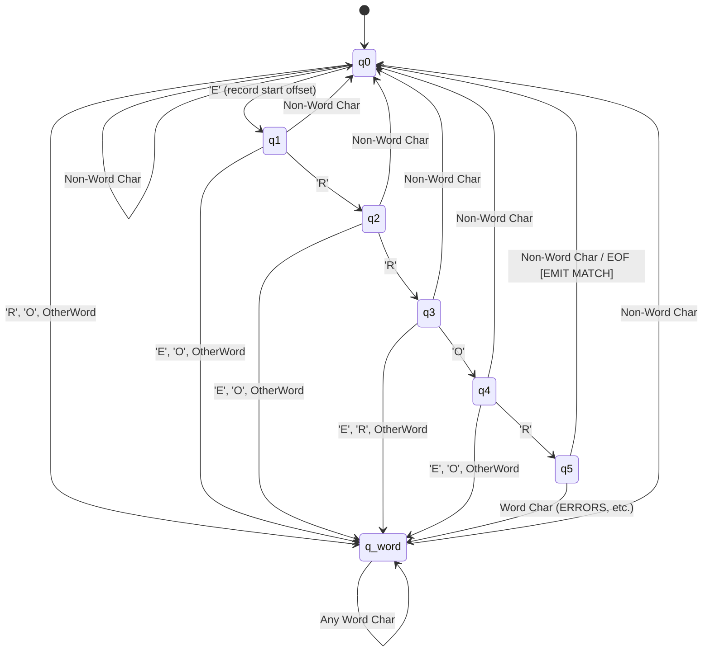
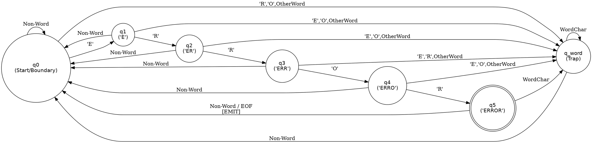

# Deterministic Finite Automaton (DFA) Design for Keyword `ERROR`

**Course:** 24CS52 — Theory of Computations | **Assignment:** SET-E Case Study

---

## 1. Formal 5-Tuple Mathematical Formulation

$$M = (Q, \Sigma, \delta, q_0, F)$$

1. **State Set $Q = \{q_0, q_1, q_2, q_3, q_4, q_5, q_{\text{word}}\}$**:
   - $q_0$: Initial / Word Boundary State.
   - $q_1$: Matched prefix `'E'` at a valid left boundary.
   - $q_2$: Matched prefix `'ER'`.
   - $q_3$: Matched prefix `'ERR'`.
   - $q_4$: Matched prefix `'ERRO'`.
   - $q_5$: Candidate `'ERROR'` recognized; awaiting right boundary confirmation.
   - $q_{\text{word}}$: Inside-Word Trap State. Absorbs word characters until reset by a delimiter.

2. **Input Alphabet Equivalence Classes ($\Sigma$)**:
   - $C_E = \{ \mathtt{'E'} \}$
   - $C_R = \{ \mathtt{'R'} \}$
   - $C_O = \{ \mathtt{'O'} \}$
   - $C_{\text{other\_word}} = \{ \mathtt{'a'}\text{--}\mathtt{'z'}, \mathtt{'A'}\text{--}\mathtt{'Z'}, \mathtt{'0'}\text{--}\mathtt{'9'}, \mathtt{'\_'} \} \setminus \{ \mathtt{'E'}, \mathtt{'R'}, \mathtt{'O'} \}$
   - $C_{\text{non\_word}} = \Sigma \setminus \text{WordChars}$

3. **Start State:** $q_0$

4. **Accepting Condition ($F$):**
   In state $q_5$, if the subsequent symbol $c \in C_{\text{non\_word}}$ or at $\text{EOF}$, the match is emitted and the automaton transitions to $q_0$. If $c \in \text{WordChars}$, the automaton enters $q_{\text{word}}$ without match emission.

---

## 2. Complete Transition Table ($\delta$)

```text
+-------------------+------------+------------+------------+--------------------+-------------------+
| Current State     | Input: 'E' | Input: 'R' | Input: 'O' | Other Word Char    | Non-Word Char     |
+-------------------+------------+------------+------------+--------------------+-------------------+
| q0 (Boundary)     | q1         | q_word     | q_word     | q_word             | q0                |
| q1 (Saw 'E')      | q_word     | q2         | q_word     | q_word             | q0                |
| q2 (Saw 'ER')     | q_word     | q3         | q_word     | q_word             | q0                |
| q3 (Saw 'ERR')    | q_word     | q_word     | q4         | q_word             | q0                |
| q4 (Saw 'ERRO')   | q_word     | q5         | q_word     | q_word             | q0                |
| q5 (Saw 'ERROR')  | q_word     | q_word     | q_word     | q_word             | q0 [EMIT MATCH]   |
| q_word (Trap)     | q_word     | q_word     | q_word     | q_word             | q0                |
+-------------------+------------+------------+------------+--------------------+-------------------+
```

---

## 3. State-Transition Diagram



---

## 4. Graphviz DOT Representation



